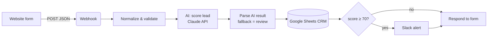

# AI Lead Qualifier — n8n workflow

Website contact form → **AI scores the lead (0–100)** → row in **Google Sheets** (lightweight CRM) → **Slack alert** for hot leads → instant answer to the form.

The kind of "glue" automation small businesses ask for most: no new software to learn, works with the tools they already use, and the sales team only spends time on leads worth calling.

## What's inside

| File | Purpose |
|---|---|
| `workflow.json` | n8n workflow — import via *Workflows → Import from file* |
| `lead-form.html` | Accessible demo contact form that posts to the webhook |
| `sample-leads.http` | Two test leads (hot / cold) for VS Code REST Client or similar |

## How it works

- **Normalize lead** — trims fields, lower-cases email, rejects invalid emails, caps message length, builds the AI prompt.
- **AI: score lead** — calls the Anthropic Messages API and asks for strict JSON: `score`, `category` (hot / warm / cold / spam), one-line `summary` and a `suggested_reply`. Retries once; if it still fails the workflow continues.
- **Parse AI result** — merges the verdict with the lead. If the AI call failed or returned bad JSON, the lead is saved as `review` instead of being lost.
- **Add to CRM sheet** — appends one row per lead (columns are mapped automatically by name).
- **Hot lead?** — score ≥ 70 triggers a Slack message with the summary and contact.
- **Respond to form** — returns `{ ok, category, message }` to the website.

## Setup (≈10 minutes)

1. Import `workflow.json` into n8n (cloud or self-hosted).
2. **AI: score lead** → create a *Header Auth* credential: name `x-api-key`, value = your Anthropic API key. (Any LLM API works with a small change in the request body.)
3. **Add to CRM sheet** → connect Google Sheets and paste your sheet URL. Create a tab named `Leads` with the headers:
   `received_at, name, email, company, website, budget, message, score, category, summary, suggested_reply`
4. **Slack alert** → paste your Slack incoming-webhook URL.
5. Activate the workflow and set `WEBHOOK_URL` in `lead-form.html` to the production webhook URL.

## Easy extensions

Send the `suggested_reply` as an automatic email (Gmail/SMTP), push hot leads to HubSpot/Pipedrive instead of Sheets, or add a weekly summary report.

---
Built by **Eduardo — Winner Tecnologia**. Available for n8n / Make / Zapier automations and API integrations.
